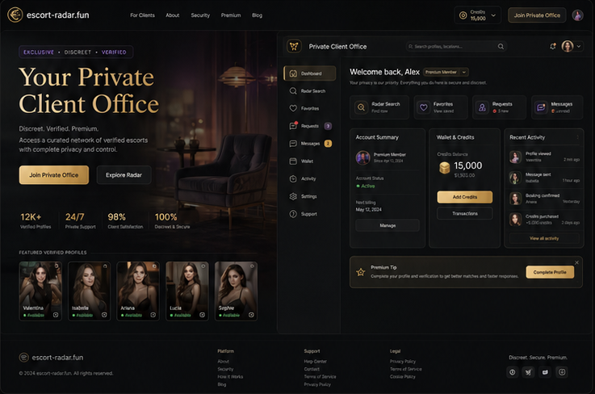
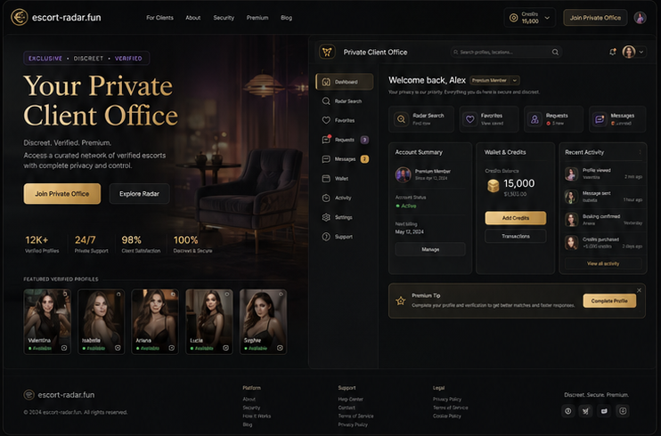
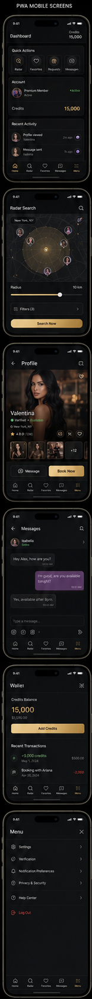
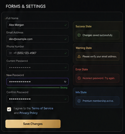
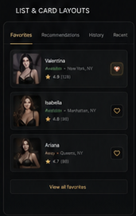
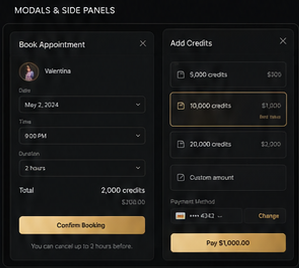

# Dashboard klienta — Private Client Office

## Trasa i komponent

- Trasa: `/dashboard` dla konta `client`
- Komponent: `DashboardPage` → `ClientDashboard`

## Nadrzędne mockupy

Uzupełniające:

## Struktura od góry do dołu

### Desktop

1. Globalny header.
2. Sekcja marketingowa „Your Private Client Office” z CTA i metrykami.
3. Właściwe biuro:
   - sidebar z nawigacją;
   - topbar z nazwą, wyszukiwaniem, kredytami i kontem;
   - powitanie;
   - szybkie akcje: Radar, Favorites, Requests, Messages;
   - Account Summary, Wallet & Credits, Recent Activity;
   - premium tip/uzupełnienie profilu.
4. Footer.

### Mobile

1. Zwarty tytuł Dashboard i saldo kredytów.
2. Quick Actions.
3. Account/status.
4. Credits.
5. Recent Activity.
6. Czarny bottom navbar.

## Zachowanie desktopowe

- Sidebar jest stały w obrębie biura, a główna treść elastyczna.
- Karty mają równą hierarchię i nie zamieniają dashboardu w gęsty admin panel.
- Saldo i aktywacja premium są wyraźne, ale nie zasłaniają głównych zadań.

## Zachowanie mobilne

- Desktopowy sidebar przechodzi w menu/bottom navigation.
- Quick Actions są dostępne na pierwszym ekranie.
- Karty układają się w jedną kolumnę.
- Nawigacja i safe area nie zasłaniają aktywności ani działań.

## Elementy obowiązkowe

- rozpoznanie konta `client`;
- status aktywacji i profilu;
- Radar, favorites, wallet, requests/intent, messages/notifications;
- saldo i transakcje;
- ustawienia oraz logout;
- aktywność i pobliskie profile;
- formularz profilu osobistego oraz status weryfikacji.

## Funkcje, które muszą pozostać

- auth i role resolution;
- BCU/legacy wallet zgodnie z backendem;
- premium activation;
- favorites i tokenowe ograniczenia;
- intent/request oraz nearby advertisers;
- notifications;
- avatar i personal profile;
- routing do Radaru, profili, walletu i ustawień.

## Czego nie dodawać

- fikcyjnego salda, aktywności, profili lub statusu premium;
- przycisków bez działającej trasy/akcji;
- elementów dashboardu reklamodawcy;
- nowych benefitów premium bez backendu i modelu płatności.

## Stany

- Loading: szkielet dashboardu bez skoku layoutu.
- Empty: osobno dla favorites, aktywności, requestów i pobliskich profili.
- Error: retry dla danych biura.
- Premium lock: pokazuje aktualny status i istniejącą ścieżkę aktywacji.

## Viewporty kontroli

- desktop `1440×900`;
- mobile `390×844`;
- mobile menu oraz wallet również `390×844`.

## Checklista akceptacji

- [ ] Sidebar/topbar i układ kart odpowiadają mockupowi desktop.
- [ ] Quick Actions są pierwszoplanowe na mobile.
- [ ] Rzeczywiste saldo i statusy są poprawne.
- [ ] Wszystkie linki i akcje działają.
- [ ] Empty/loading/error/premium lock są czytelne.
- [ ] Bottom navbar nie zasłania treści.
- [ ] Brak danych demo.
- [ ] Screenshoty desktop/mobile porównano i obejrzano.
- [ ] Właściciel zaakceptował PNG.
