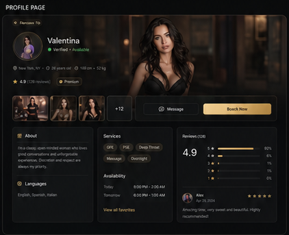
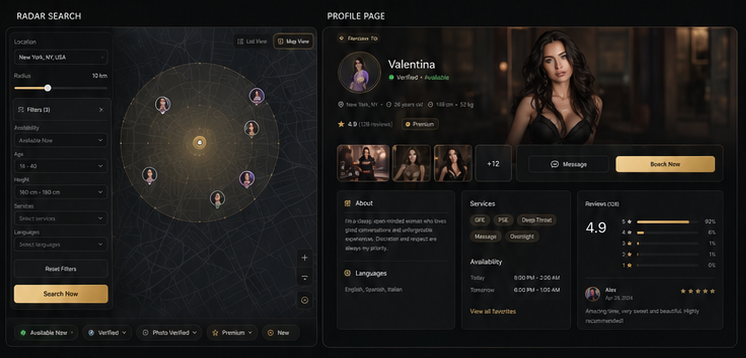
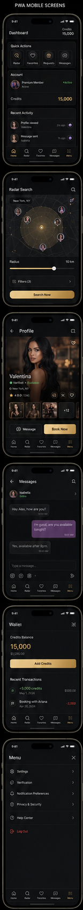
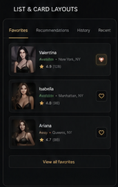
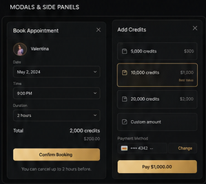

# Profil publiczny

## Trasa i komponent

- Trasa: `/profile/:id`
- Komponent: `ProfilePage`

## Nadrzędne mockupy

Uzupełniające komponenty:

## Struktura od góry do dołu

### Desktop

1. Powrót/kontekst profilu.
2. Tożsamość, avatar, nazwa, status, lokalizacja i podstawowe fakty.
3. Duże zdjęcie hero.
4. Miniatury galerii.
5. Główne akcje `Message` i złote `Book Now`.
6. Sekcje About/Languages, Services/Availability oraz Reviews.

### Mobile

1. Kompaktowy header z powrotem i akcjami.
2. Pełnoszerokie zdjęcie hero z overlayem danych.
3. Status, ocena i skrócone fakty.
4. Miniatury.
5. Dostępne działania.
6. Bottom navbar.

## Zachowanie desktopowe

- Hero i dane profilu tworzą jeden spójny premium panel.
- Galeria i CTA są widoczne bez szukania po stronie.
- Sekcje szczegółów zachowują zwartą siatkę, ale nie mogą usuwać istniejących zakładek i funkcji.
- Sticky/aside działań nie może zasłaniać treści.

## Zachowanie mobilne

- Najważniejsze zdjęcie i tożsamość dominują pierwszy ekran.
- Akcje mają touch target minimum `44px`.
- Długie szczegóły mogą układać się sekwencyjnie.
- Bottom navbar nie zasłania CTA, galerii ani formularzy.

## Elementy obowiązkowe

- zdjęcia i fullscreen gallery;
- nazwa, status, weryfikacja, lokalizacja i fakty;
- About, availability, services/prices, reviews;
- wiadomość/czat, telefon i booking zgodnie z istniejącymi uprawnieniami;
- favorites, gifts, live/video i VIP gallery, jeśli dostępne;
- similar profiles i report/safety;
- obsługa profilu sponsorowanego.

## Funkcje, które muszą pozostać

- API profilu i routing;
- premium activation i ochrona danych kontaktowych;
- tokenowe akcje oraz wallet system;
- booking, favorites, gift, videochat, chat i report;
- galeria publiczna/prywatna;
- realne statusy i harmonogram.

## Czego nie dodawać

- fikcyjnych ocen, recenzji, cen, zdjęć lub dostępności;
- danych kontaktowych omijających premium lock;
- nowych płatnych działań bez kontraktu backendowego;
- treści profilu wpisanej na stałe.

## Stany

- Loading: skeleton o proporcjach hero i paneli.
- Empty: brak zdjęcia lub sekcji ma zachować strukturę i czytelny fallback.
- Error: retry i bezpieczny komunikat.
- Premium lock: wyjaśnia blokadę, pokazuje istniejące CTA aktywacji i nie ujawnia chronionych danych.

## Viewporty kontroli

- desktop `1440×900`;
- mobile `390×844`;
- galerie i modale również na `390×844`.

## Checklista akceptacji

- [ ] Hierarchia hero/tożsamość/CTA odpowiada mockupowi.
- [ ] Desktop zachowuje czytelną siatkę.
- [ ] Mobile pokazuje zdjęcie i kluczowe akcje na początku.
- [ ] Wszystkie istniejące funkcje i locki pozostały.
- [ ] Brak fikcyjnych danych.
- [ ] Loading, error i brak zdjęcia zostały sprawdzone.
- [ ] Modale nie wychodzą poza viewport.
- [ ] Screenshoty desktop/mobile porównano i obejrzano.
- [ ] Właściciel zaakceptował PNG.
