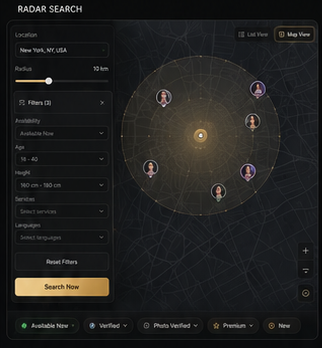
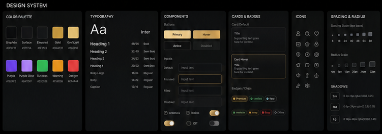
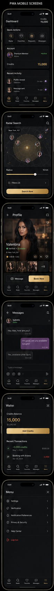

# Radar

## Trasa i komponenty

- Trasa: `/city/:city`
- Główne komponenty: `CityPage`, `RadarPanel`

## Nadrzędne mockupy

Uzupełniające: [Klient_Radar.png](../../Mockup/Klient_Radar.png) i [kreacja promocyjna](<../../Mockup/Generated Image June 09, 2026 - 3_35PM.png>).

## Struktura od góry do dołu

### Desktop

1. Zwarty tytuł „Radar Search”.
2. Jedna rama robocza:
   - lewy pionowy panel: lokalizacja, radius, filtry, dodatkowe kryteria, reset, szerokie złote `Search Now`;
   - dominująca prawa scena radaru z mapowym/topograficznym tłem.
3. Dolna legenda/badge statusów i cech.

### Mobile

1. Kompaktowy header.
2. Tytuł „Radar Search”.
3. Mały pill lokalizacji.
4. Radar.
5. Radius.
6. Zwijany wiersz filtrów.
7. Szerokie złote `Search Now`.
8. Czarny/grafitowy bottom navbar z aktywnym Radarem.

## Zachowanie desktopowe

- Panel filtrów jest pionowy i mieści podstawowe kontrolki oraz CTA w `1440×900`.
- Scena radaru zajmuje większość szerokości.
- Tło przypomina ciemną mapę/topografię, ale nie zmienia radaru w zwykłą mapę.
- Pierścienie, sektor skanowania, złoty środek i markery pozostają nad tłem.
- Markery są klikalne i prowadzą do istniejącego profilu/karty.
- Nie dodawać odrębnego bloku statystyk nad główną ramą, jeśli nie pokazuje go mockup.

## Zachowanie mobilne

- Jedna kolumna bez overflow.
- Radar jest widoczny wysoko na pierwszym ekranie i ma zwarty empty state.
- Radius, filtr i CTA są pod radarem w kolejności mockupu.
- Touch targety mają minimum `44px`.
- Bottom navbar uwzględnia safe area i nie zasłania lokalizacji, filtrów ani CTA.

## Elementy obowiązkowe

- lokalizacja ręczna i GPS;
- radius oraz jego rzeczywiste ograniczenia;
- status i pozostałe istniejące filtry;
- reset;
- główne CTA;
- pierścienie, sweep, środek, markery i legenda;
- premium lock w obecnym modelu uprawnień;
- wynik/karta po interakcji z markerem;
- loading, empty i error.

## Funkcje, które muszą pozostać

- aktualne API i pula profili;
- `radarLayout`, pozycjonowanie, odległość i bearing markerów;
- klastrowanie i kliknięcia markerów;
- radius, GPS, lokalizacja ręczna i zapisana;
- filtrowanie, favorites i premium lock;
- routing do profilu;
- diagnostyka dostępna w istniejącym trybie.

## Czego nie dodawać

- danych demo w produkcyjnym kodzie;
- zwykłej mapy zastępującej radar;
- statystyk lub paneli niewidocznych w mockupie bez zgody właściciela;
- globalnych override wpływających na homepage;
- kolejnej warstwy przypadkowego CSS na końcu `styles.css`.

## Stany

- Loading: radar i panel zachowują wymiary; shimmer nie przesuwa layoutu.
- Empty: zwarty komunikat wewnątrz sceny bez zasłaniania pierścieni.
- Error: czytelny komunikat i retry.
- Premium lock: dostępny w viewport, opisuje aktywację i nie usuwa kontekstu filtrów.

## Viewporty kontroli

- desktop `1440×900` z 5–7 testowymi markerami;
- desktop `1440×900` empty;
- mobile `390×844` z markerami;
- mobile `390×844` empty;
- dodatkowo `360px` szerokości pod kątem overflow.

Fixture markerów wolno podać tylko przez test lub Playwright interception.

## Checklista akceptacji

- [ ] Panel desktop ma pionową hierarchię mockupu.
- [ ] Główne CTA jest szerokie i na dole panelu.
- [ ] Wszystkie kontrolki mieszczą się bez clippingu.
- [ ] Podstawowy panel i CTA są dostępne w `1440×900`.
- [ ] Tło ma charakter mapowo-topograficzny i radarowy.
- [ ] Markery renderują się nad tłem i są interaktywne.
- [ ] Mobile zachowuje wymaganą kolejność.
- [ ] Bottom navbar jest czarno-złoty i niczego nie zasłania.
- [ ] Screenshoty porównano z mockupami w tej samej skali.
- [ ] Porównania zostały faktycznie obejrzane.
- [ ] Kod produkcyjny nie zawiera fixture.
- [ ] Właściciel zaakceptował PNG przed commit/deploy.
